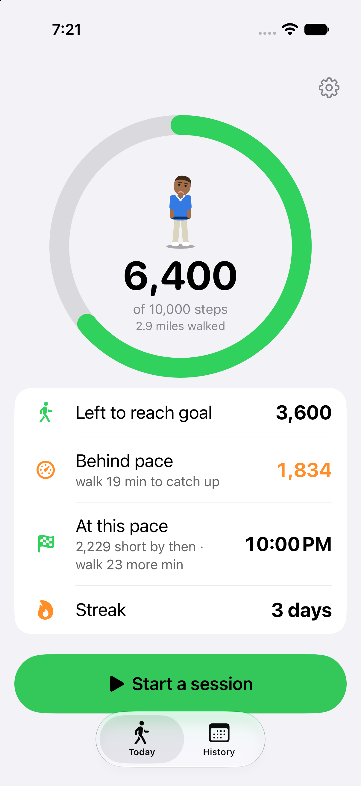
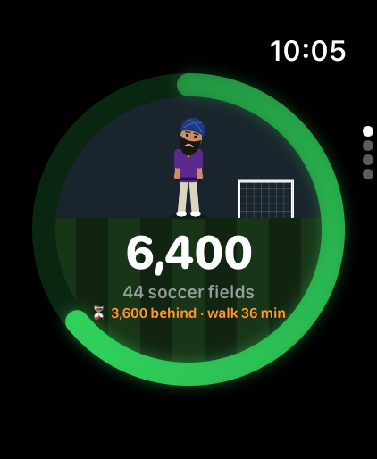
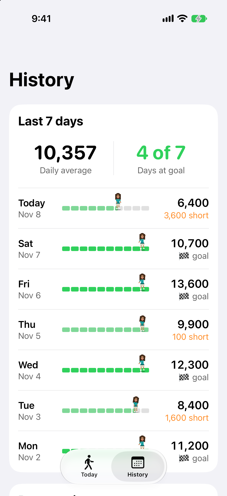
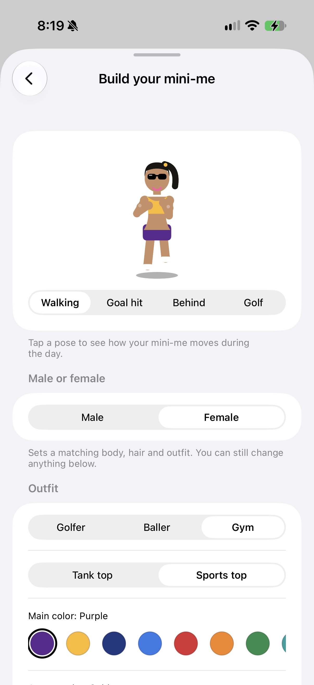
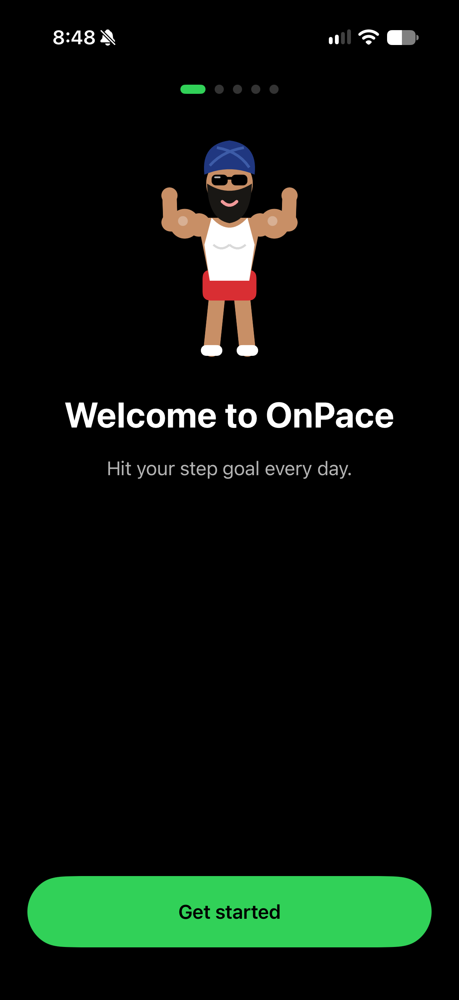
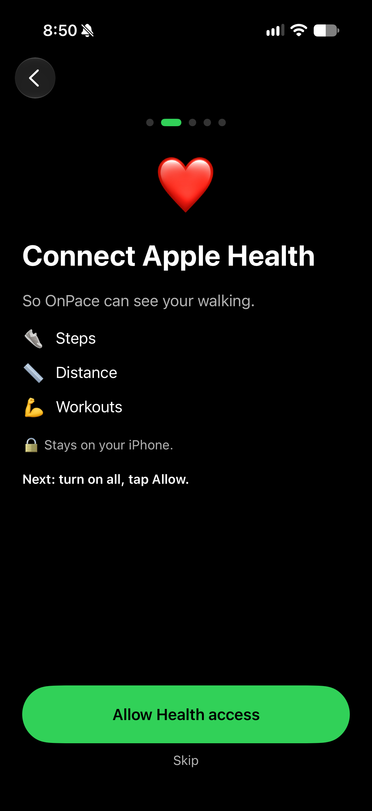
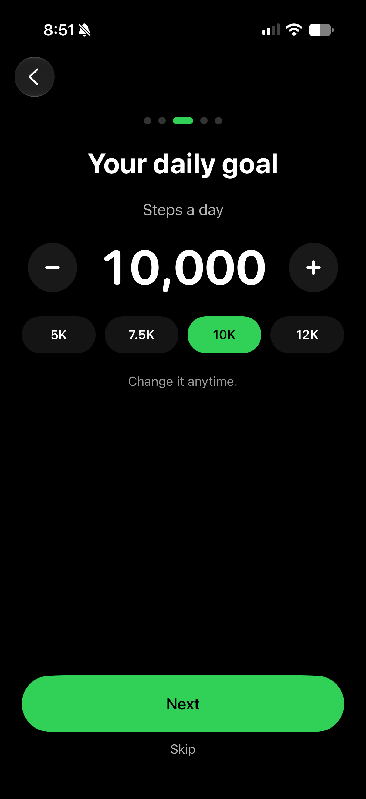
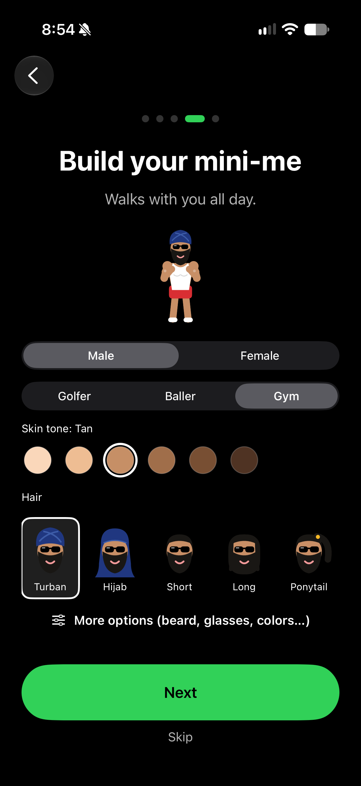
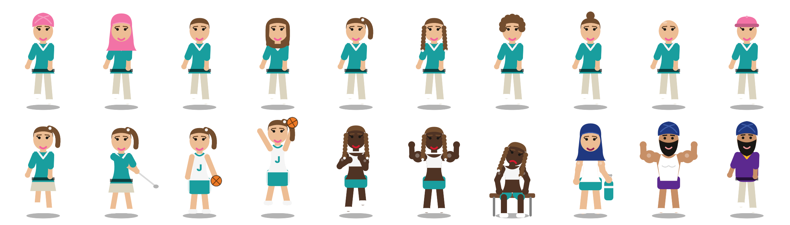
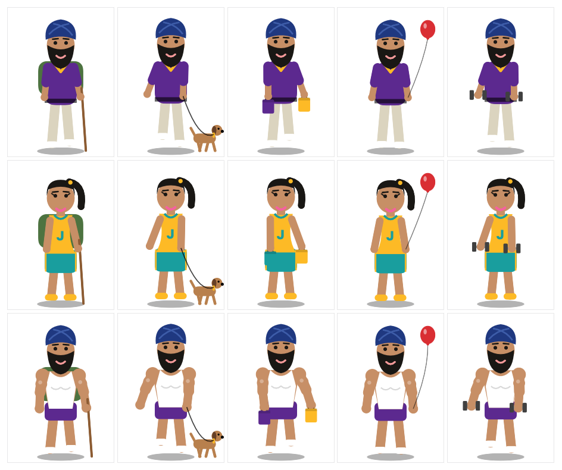

# OnPace

A step tracker for **iPhone and Apple Watch**, built with **SwiftUI** and **HealthKit**.
It reads your step count from Apple Health and shows progress toward a daily goal, with
a hand-drawn animated character that reacts to how your day is going.

  
  &nbsp;&nbsp;&nbsp;
  
  &nbsp;&nbsp;&nbsp;
  
  &nbsp;&nbsp;&nbsp;
  

## Features

**iPhone** (two tabs, Today and History, with big type and one idea per row)
- **Today:** the goal ring (2,000–30,000, default 10,000) with today's steps and how far you walked under them
  ("4.9 miles walked", or km where you use metric), then one card of rows: steps left, how far behind pace you are and
  the minutes of walking to catch up, the time you'll finish at this pace, and your streak.
  Distance is the real distance Apple Health measured with your own stride; golf sessions count holes
- One **Start a session** button opens a "What are you doing?" sheet
- **Styles:** Clean minimal (default: Apple-style grouped cards, one green ring, SF Symbols), 16-bit adventure
  (original pixel art drawn in code: mountains and a castle by day or under the stars, a gold block ring, a pixel
  mini-me built from your look with walk / stand / slump / celebrate / swing frames, RPG-style menu panels), or
  Original (emoji icons and a blue ring); theme Auto, Light, or Dark
- **Your mini-me walks when you walk:** Core Motion activity (walking / running) drives the animation only; when you
  stop it stands (on pace), slumps (behind), or celebrates (goal hit). Step counts still come only from Apple Health
- **Home-screen widget:** a small ring with today's steps and how many are left (reads Apple Health, falls back to
  the last count the app saved when the phone is locked)
- **Accessibility:** VoiceOver reads the ring and each day as one sentence; at the largest text sizes the numbers
  move under their labels instead of wrapping
- **Sessions:** golf (9 or 18 holes), hike, dog walk, shopping, theme park, workout, or a custom one you name.
  Counts only the steps between Start and End, with saved history. During a session your mini-me swings
  (golf) or walks with a prop: hiking stick + backpack, a dog on a leash, shopping bags, a balloon, or dumbbells
- **Apple Workout app:** when you end a Golf, Hike, Walk, Run, or Strength workout, it's saved as a session
  with its steps automatically (golf guesses 9 or 18 holes from the length; press and hold to change it)
- **History:** last 7 days (daily average, days at goal, and a segmented bar per day with a tiny
  animated you on it: celebrating on goal days, slumped where you stopped on missed days), then every past session
- **Build your mini-me:** a character builder with a live animated preview in every pose
  (see below)

**Apple Watch**
- Ring page centered for the Ultra 2 screen, with your mini-me, step count, distance walked ("4.9 miles walked"), pace, and a small golf scene
- Mini-me walks when you walk (Core Motion), same moods as the phone
- Stats page (streak, pace, forecast, distance) and a 7-day bar chart, paged with the Digital Crown
- **Synced from the iPhone:** goal, mini-me (outfit + whole look), and with every refresh today's steps,
  distance, streak, last 7 days, your usual-day pace pattern, and today's sessions (the watch's own copy of Apple Health
  is missing steps the iPhone counted, so the watch and its complications use the phone's numbers when they're newer)
- **Matches Apple Health exactly:** today's steps on the watch and its complications come only from the watch's
  Apple Health (same number as the Health app); the phone adds history: last 7 days, streak, usual-day pace
- **Faces stay fresh:** HealthKit background delivery wakes the watch app when new steps are saved and redraws
  the complications right away (they still read Apple Health directly)
- **Today's sessions** page: sessions you tracked and workouts from the Workout app; pick the ring color on the watch
- Watch face complications (WidgetKit): ring, steps left, and pace, for circle, corner, inline,
  and rectangle slots; they read HealthKit directly, use the goal synced from the phone, and refresh when the app opens

**First-time setup** (`Onboarding.swift`, shown once to new people)
- Four short screens, one idea each: Welcome, Apple Health (what's read and why, stays on your iPhone),
  daily goal (− / + and 5K–12K picks), build your mini-me (body, outfit, skin, hair, with "More options" for the
  full builder). Every step can be skipped. People who used the app before setup existed skip it,
  and Settings has "Show setup again".

  
  
  
  

**Animated characters** (`Characters.swift`, `CharacterBuilder.swift`)
- Drawn entirely in code with SwiftUI `Canvas` + `TimelineView` on a 100×140 grid. No image assets.
- Three outfits with the same poses: Golfer (pants or skort), Baller (jersey with your letter),
  and Gym (tank or sports top)
- Build your mini-me: male or female body, 6 skin tones, 10 hair styles and head coverings (turban, hijab,
  short, long, ponytail, braids, curly, bun, bald, cap), beard, glasses, eyelashes, lip color, and
  main / accent / headwear colors from a 12-color palette
- Male / Female sets matching defaults (body, hair, outfit), and every option stays open to change
- Mood follows you: swings during a golf round, walks while you walk, celebrates at goal, stands when on pace, slumps when behind

  

  

## How it works

- **HealthKit:** `HKStatisticsCollectionQueryDescriptor` sums steps per day for the last 61 days
  (for the streak and 7-day history); `HKStatisticsQueryDescriptor` sums steps between two times for golf rounds.
- **Personal pace curve:** learns your usual day from the last 30 days of hourly HealthKit data
  (the share of a day's steps you've usually done by each hour, averaged over days with 2,000+ steps).
  "On pace" means on track compared with your own normal day, not a flat line. Until there are 7 such
  days, it falls back to walking evenly from 7am to 10pm.
- **Catch-up:** when behind, it says how many steps and how many minutes of walking (~100 steps/min)
  it takes to catch up.
- **Forecast:** scales today's steps by how much of your usual day is done to say what time you'll
  reach your goal, or how many steps short you'll be by your usual end of day (and how many more
  minutes of walking would close the gap). One shared `Pace.swift` drives the phone, watch, and complications.
- **Your look:** one `Look` struct (Codable, saved as JSON in `@AppStorage`) drives every drawing.
  Missing fields fall back to defaults when decoding, so adding new options never resets a saved look.
- **Phone → watch sync:** the iPhone is the source of truth. `PhoneSync` sends goal and mini-me with
  WatchConnectivity's application context (the watch always gets the latest copy, even if it was asleep).
  `WatchSync` saves them in an App Group, which both the watch app and its WidgetKit complications read.
- **Workouts:** an `HKAnchoredObjectQueryDescriptor` picks up newly finished workouts each time the app refreshes.
  The saved anchor means each workout is looked at once (a deleted session never comes back, and a workout that
  syncs from the watch late still counts). Workouts that overlap a session you tracked in the app are skipped.
- **Sessions:** one `SessionRecord` list (stored under the original golf-rounds key; old rounds
  load as golf). `FunUnit` converts the measured walking + running distance (HealthKit
  `distanceWalkingRunning`) into miles or km (from the phone's region), and golf sessions into holes; it falls back to ~0.76 m per step without it.
- **Testing:** checked in the iOS Simulator with debug-only `-demoSteps`, `-appStyle`, and `-demoWalking` launch
  arguments that fake steps, pick a style, and fake walking.
- **State:** settings and sessions are stored with `@AppStorage`; data refreshes whenever the app becomes active.
- **Layout:** the watch ring is centered on the physical screen (`WKInterfaceDevice.screenBounds`)
  instead of the safe area, so it stays centered next to the clock and page indicator.

## Tech

Swift · SwiftUI · HealthKit · WidgetKit (watch complications + iPhone widget) · WatchConnectivity · App Groups · Combine · WatchKit · Xcode 27 · iOS 27 / watchOS 27

## Run it

1. Open `Steps.xcodeproj` in Xcode.
2. Set your own Team under **Signing & Capabilities** for both targets (and change the bundle id if needed).
3. Run on a real iPhone / Apple Watch (Health data isn't available in the simulator) and allow Health access.
