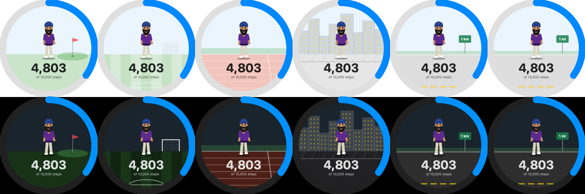

# Steps

A personal step tracker for **iPhone and Apple Watch**, built with **SwiftUI** and **HealthKit**.
It reads your step count from Apple Health and shows progress toward a daily goal, with
a hand-drawn animated character that reacts to how your day is going.

  
  &nbsp;&nbsp;&nbsp;
  
  &nbsp;&nbsp;&nbsp;
  

## Features

**iPhone**
- Daily goal ring (2,000–30,000, default 10,000) with today's steps and steps to go
- Streak of consecutive days at goal, pace check, and a **fun unit**: your steps shown as golf holes,
  soccer fields, track laps, city blocks, km, or miles (picked in Settings)
- The ring shows a scene for your fun unit behind your mini-me: golf green, soccer field, running track,
  city skyline, or a road with a distance sign (light and dark mode)
- **Sessions:** golf (9 or 18 holes), hike, dog walk, shopping, theme park, workout, or a custom one you name.
  Counts only the steps between Start and End, with saved history. During a session your mini-me swings
  (golf) or walks with a prop: hiking stick + backpack, a dog on a leash, shopping bags, a balloon, or dumbbells
- Last 7 days table: days at goal, daily average, best day, and a segmented bar per day with a tiny
  animated you on it: celebrating at ⛳ on goal days, slumped where you stopped (and steps short) on missed days
- **Build your mini-me:** a character builder with a live animated preview in every pose
  (see below)
- Themes: Auto (system), Dark, Purple & gold, Golf green

**Apple Watch**
- Ring page centered for the Ultra 2 screen, with your mini-me, step count, and the same fun-unit scene as the phone
- Stats page (streak, pace, forecast, your fun unit) and a 7-day bar chart, paged with the Digital Crown
- **Synced from the iPhone:** goal, mini-me (outfit + whole look), and fun unit; pick the ring color on the watch
- Watch face complications (WidgetKit): ring, steps left, and pace, for circle, corner, inline,
  and rectangle slots; they read HealthKit directly, use the goal synced from the phone, and refresh when the app opens

**Animated characters** (`Characters.swift`, `CharacterBuilder.swift`)
- Drawn entirely in code with SwiftUI `Canvas` + `TimelineView` on a 100×140 grid. No image assets.
- Three outfits with the same poses: Golfer (pants or skort), Baller (jersey with your letter),
  and Gym (tank or sports top)
- Build your mini-me: male or female body, 6 skin tones, 10 hair styles and head coverings (turban, hijab,
  short, long, ponytail, braids, curly, bun, bald, cap), beard, glasses, eyelashes, lip color, and
  main / accent / headwear colors from a 12-color palette
- Male / Female sets matching defaults (body, hair, outfit), and every option stays open to change
- Mood follows your progress: swings during a golf round, celebrates at goal, walks when on pace, slumps when behind

  

  

  

## How it works

- **HealthKit:** `HKStatisticsCollectionQueryDescriptor` sums steps per day for the last 61 days
  (for the streak and 7-day history); `HKStatisticsQueryDescriptor` sums steps between two times for golf rounds.
- **Personal pace curve:** learns your usual day from the last 30 days of hourly HealthKit data
  (the share of a day's steps you've usually done by each hour, averaged over days with 2,000+ steps).
  "On pace" means on track compared with your own normal day, not a flat line. Until there are 7 such
  days, it falls back to walking evenly from 7am to 10pm.
- **Catch-up:** when behind, it says how many steps and how many minutes of walking (~100 steps/min)
  it takes to catch up.
- **Forecast:** scales today's steps by how much of your usual day is done to say what time you'll
  reach your goal, or how many steps short you'll be by your usual end of day (and how many more
  minutes of walking would close the gap). One shared `Pace.swift` drives the phone, watch, and complications.
- **Your look:** one `Look` struct (Codable, saved as JSON in `@AppStorage`) drives every drawing.
  Missing fields fall back to defaults when decoding, so adding new options never resets a saved look.
- **Phone → watch sync:** the iPhone is the source of truth. `PhoneSync` sends goal, mini-me, and fun unit with
  WatchConnectivity's application context (the watch always gets the latest copy, even if it was asleep).
  `WatchSync` saves them in an App Group, which both the watch app and its WidgetKit complications read.
- **Sessions:** one `SessionRecord` list (stored under the original golf-rounds key; old rounds
  load as golf). `FunUnit` converts steps with rough averages (~0.76 m per step).
- **State:** settings and sessions are stored with `@AppStorage`; data refreshes whenever the app becomes active.
- **Layout:** the watch ring is centered on the physical screen (`WKInterfaceDevice.screenBounds`)
  instead of the safe area, so it stays centered next to the clock and page indicator.

## Tech

Swift · SwiftUI · HealthKit · WidgetKit · WatchConnectivity · App Groups · Combine · WatchKit · Xcode 27 · iOS 27 / watchOS 27

## Run it

1. Open `Steps.xcodeproj` in Xcode.
2. Set your own Team under **Signing & Capabilities** for both targets (and change the bundle id if needed).
3. Run on a real iPhone / Apple Watch (Health data isn't available in the simulator) and allow Health access.
